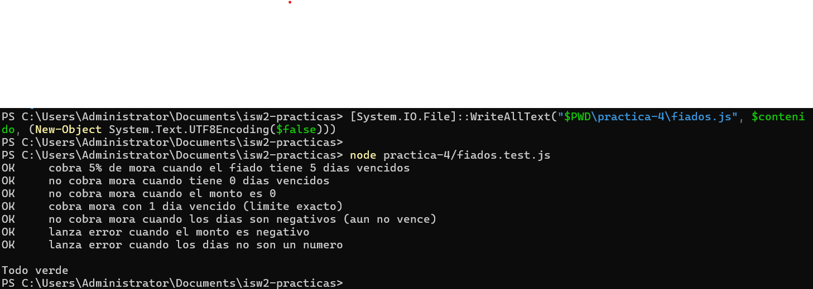

# Evidencia - Practica 4

Salida de node fiados.test.js con la suite en verde:

```
OK     cobra 5% de mora cuando el fiado tiene 5 dias vencidos
OK     no cobra mora cuando tiene 0 dias vencidos
OK     no cobra mora cuando el monto es 0
OK     cobra mora con 1 dia vencido (limite exacto)
OK     no cobra mora cuando los dias son negativos (aun no vence)
OK     lanza error cuando el monto es negativo
OK     lanza error cuando los dias no son un numero

Todo verde
```

