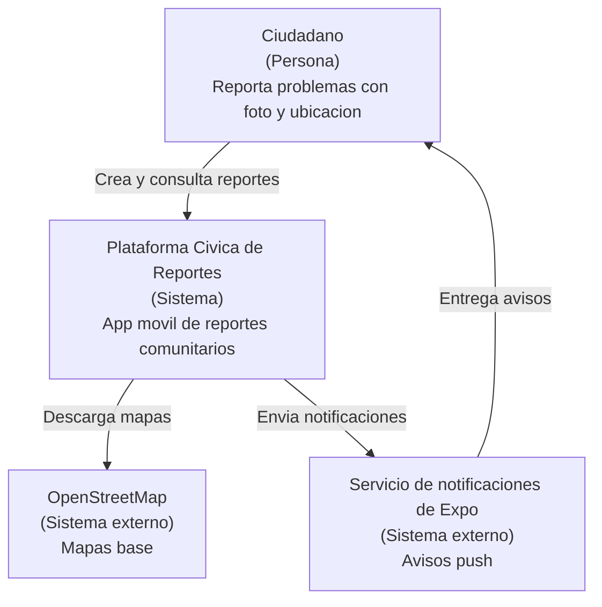

# Arquitectura C4 - Plataforma Civica de Reportes

## Nivel 1: Contexto

### Decisiones de calidad (nivel 1)

1. Elegi una app movil y no una pagina web porque priorizo usabilidad en el momento del reporte sobre rapidez de desarrollo: la gente reporta desde el celular, con la camara y el GPS a mano.
2. Elegi OpenStreetMap como mapa externo y no Google Maps porque priorizo costo y libertad de uso sobre funciones avanzadas: no hay que pagar ni manejar llaves de facturacion.
3. Los pagos de ayuda comunitaria quedan fuera del sistema (solo se muestran datos de contacto) porque priorizo seguridad y simplicidad sobre comodidad de pago.
4. Las notificaciones push dependen de un servicio externo, asi que acepto menos control a cambio de no mantener infraestructura propia.
5. El ciudadano es el unico actor del sistema, lo que mantiene el alcance chico y alcanzable en el tiempo del curso.