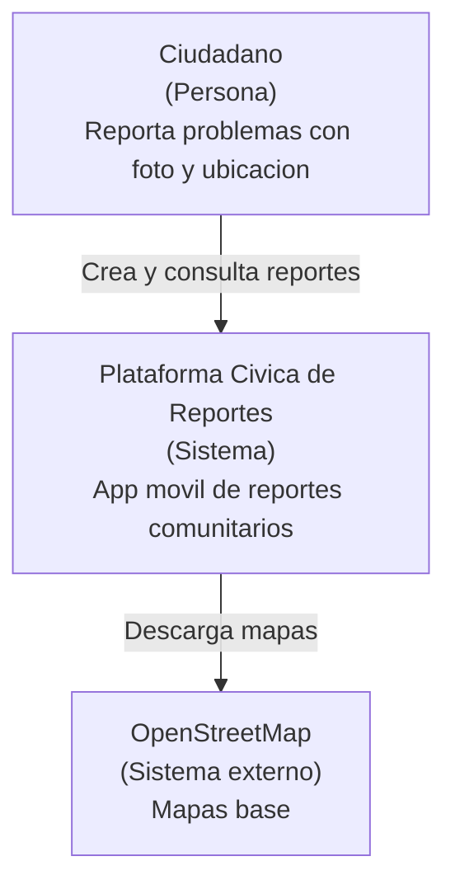
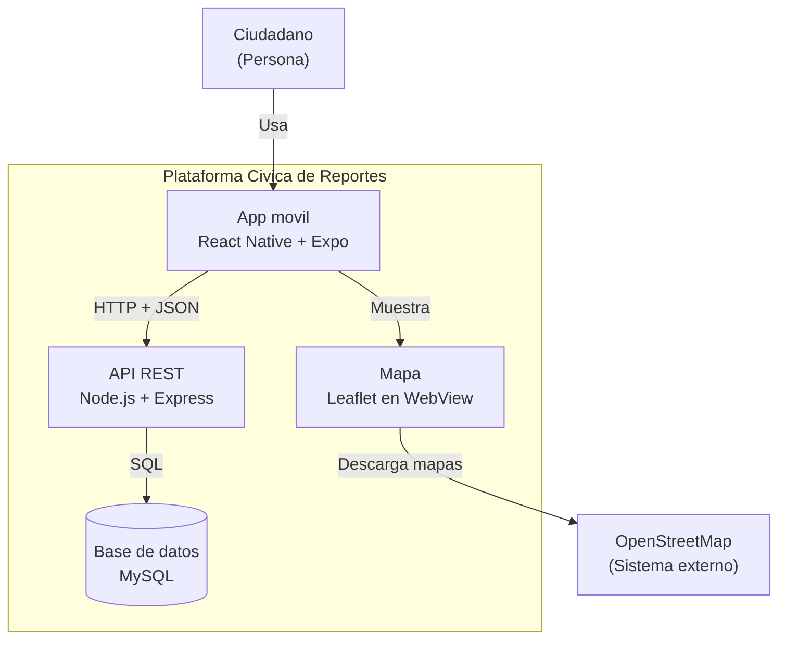

# Arquitectura C4 - Plataforma Civica de Reportes

## Nivel 1: Contexto

### Decisiones de calidad (nivel 1)

1. Elegi una app movil y no una pagina web porque priorizo usabilidad en el momento del reporte sobre rapidez de desarrollo: la gente reporta desde el celular, con la camara y el GPS a mano.
2. Elegi OpenStreetMap como mapa externo y no Google Maps porque priorizo costo y libertad de uso sobre funciones avanzadas: no hay que pagar ni manejar llaves de facturacion.
3. El ciudadano es el unico actor del sistema, lo que mantiene el alcance chico y alcanzable en el tiempo del curso.
## Nivel 2: Contenedores

### Decisiones de calidad (nivel 2)

1. Elegi React Native con Expo y no desarrollo nativo separado porque priorizo mantenibilidad y rapidez de entrega sobre rendimiento maximo: un solo codigo para el celular.
2. Elegi Node.js con Express para la API porque priorizo mantenibilidad: el mismo lenguaje (JavaScript) en app y backend reduce el cambio de contexto y la curva de aprendizaje.
3. Elegi MySQL porque priorizo integridad de datos sobre flexibilidad: los reportes, usuarios y categorias son relacionales y se consultan con joins.
4. Separe la app de la API para que la logica de negocio no viva en el celular, lo que mejora la seguridad y permite cambiar la interfaz sin tocar los datos.
5. Uso Leaflet dentro de un WebView porque priorizo costo y simplicidad sobre rendimiento nativo del mapa; acepto que sea un poco mas lento.

## Correcciones a la IA

El borrador generado con IA lo revise contra mi proyecto real y corregi esto:

- Quite el servicio de notificaciones push de Expo que propuso la IA, porque todavia no esta implementado en mi proyecto; el diagrama solo muestra lo que existe hoy.
- Elimine la decision sobre pagos de ayuda comunitaria, porque mi plataforma no maneja pagos y esa parte no pertenecia al sistema.
- Ajuste la justificacion del mapa: uso Leaflet dentro de un WebView con OpenStreetMap, no Google Maps ni una libreria nativa; verifique cada contenedor contra mi codigo real.
